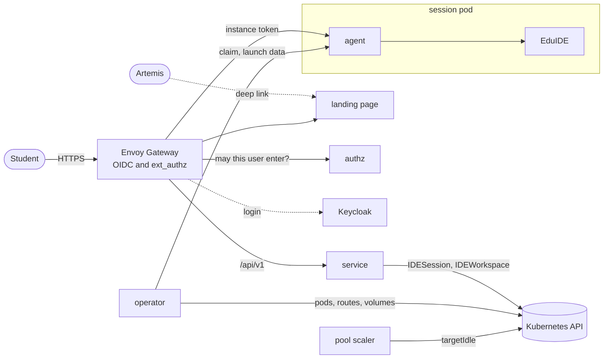

<p align="center">
  
</p>

<h1 align="center">EduIDE control plane</h1>

<p align="center">
  Browser IDEs for students on Kubernetes: start in seconds, keep the files, only the owner gets in.
</p>

<p align="center">
  <a href="https://github.com/EduIDE/EduIDE-control-plane/actions/workflows/ci.yml"></a>
  <a href="https://github.com/EduIDE/EduIDE-control-plane/actions/workflows/images.yml"></a>
  
  
</p>

> **Experimental.** This control plane replaces [EduIDE-Cloud](https://github.com/EduIDE/EduIDE-Cloud), which still runs production today.

## What it does

A student clicks a programming exercise in [Artemis](https://github.com/ls1intum/Artemis) or picks a language on the landing page.
A few seconds later an [EduIDE](https://github.com/EduIDE/EduIDE) opens in the browser, with the exercise cloned and git set up.

- **Fast:** pools of prewarmed IDEs answer a launch in about 30 ms; a cold start takes 2 to 5 seconds.
- **Saved or temporary:** a workspace keeps the files across sessions; a temporary session starts from scratch.
- **Private:** the gateway lets only the owner into a session, and an idle session ends by itself.
- **Observable:** every launch is one trace from the click to the usable IDE; metrics, alerts and a Grafana dashboard come with the chart.

## Architecture



| Component | Role |
|---|---|
| **operator** | Reconciles the custom resources `IDETemplate`, `IDEPool`, `IDESession` and `IDEWorkspace`; claims prewarmed instances, enforces timeouts and capacity |
| **service** | REST API `/api/v1` for the landing page, with OIDC, launch validation and live updates over Server-Sent Events |
| **authz** | Envoy ext_authz: only the owner of a `Ready` session reaches its IDE |
| **agent** | Sidecar in every session pod: checks the instance token, holds the launch data, reports activity |
| **pool scaler** | Sets how many idle IDEs each pool keeps warm |
| **landing page** | Launch page, overview of sessions and workspaces, status page, admin panel |

More: [architecture overview](docs/architecture/overview.md), [start path](docs/architecture/start-path.md), [session access](docs/architecture/session-access.md), UML diagrams of [components](docs/architecture/diagrams/components.svg), [deployment](docs/architecture/diagrams/deployment.svg) and the [object model](docs/architecture/diagrams/object-model.svg), and the [architecture decisions](docs/adr/README.md).

## Install

Two Helm charts from `oci://ghcr.io/eduide/eduide-control-plane/charts`:

1. `eduide-control-plane-crds` once per cluster.
2. `eduide-control-plane` (and `eduide-landing-page`) once per deployment namespace.

Needs Kubernetes with Gateway API, Envoy Gateway v1.8 or newer, cert-manager, a CNI that enforces NetworkPolicies and a Keycloak realm.
The [install guide](docs/operations/install.md) lists every value and secret.
Images: `ghcr.io/eduide/eduide-control-plane/{operator,service,authz,agent,pool-scaler,landing-page}`.

## Contributing

### Set up

You need Go 1.27, Node.js LTS, Docker, kind, kubectl, helm and golangci-lint ([full list](docs/development/setup.md)).

```bash
git clone https://github.com/EduIDE/EduIDE-control-plane.git
cd EduIDE-control-plane
make generate   # code from the contracts in api/
make build
make test       # unit, envtest and TypeScript tests
make lint
```

### Find your way

| Path | Content |
|---|---|
| `api/` | The contracts: CRD types, REST API (`openapi/v1.yaml`), agent protocol |
| `cmd/`, `internal/` | The four Go binaries and their packages |
| `pool-scaler/`, `landing-page/`, `extensions/eduide-session/` | Pool scaler, landing page, IDE extension |
| `charts/` | Helm charts |
| `test/e2e/` | End-to-end tests on kind |
| `docs/` | Architecture, ADRs, contracts, operations, development |

[AGENTS.md](AGENTS.md) has the full layout, the commands and the rules; coding agents read it too.

### Rules that save you a review round

- **Contracts first.** API and CRD changes are additive within a version and start in `api/`. Run `make generate` afterwards and never edit generated files (`*.gen.go`, `zz_generated*.go`, `config/`, `schema.gen.ts`).
- **Tests come with the change.** Table-driven unit tests, envtest for controllers, `make e2e` for anything on the request path ([testing guide](docs/development/testing.md)).
- **Never hit a real cluster by accident.** Local cluster commands use the kind kubeconfig: `export KUBECONFIG=$(pwd)/.e2e/kubeconfig`, then check that the server is `127.0.0.1`. Your default kube context may be production.
- **No user data where it does not belong.** Tokens and launch data never go into CR specs, logs, traces, metrics or status.
- **No university-specific defaults.** Hosts, realms and node labels live in deployment values, not in this repository.
- **Decisions get an ADR.** Anything beyond an additive change needs a record in [docs/adr](docs/adr/README.md).
- **Words.** Template, Pool, Instance, Session, Workspace, Claim, Release, launch data. Docs are English, active voice, present tense.

### Run the end-to-end tests

```bash
make e2e        # kind cluster with Envoy Gateway, Calico, Keycloak; full matrix and browser tests
make e2e-down   # remove the cluster
```

`EG_VERSION=v1.10.0 make e2e` runs the suite against another Envoy Gateway version.

### Open a pull request

Branch from `main`, keep the change focused, and describe what you tested.
CI runs lint, tests, generated-code and contract checks, image builds and Trivy; a pull request also builds images tagged `pr-<number>` that you can deploy to a test environment.
Releases follow [docs/development/release.md](docs/development/release.md).

## License

[Eclipse Public License 2.0](LICENSE).
