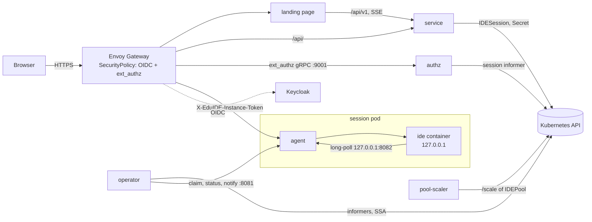

# Architecture overview

The control plane starts browser IDEs for students on Kubernetes.
One deployment (one namespace, for example a course or an exam) runs its own operator, service and authz.
Deployments share nothing ([ADR 0014](../adr/0014-operator-service-per-deployment.md)).

Status: **experimental**. Parts that are planned but not built yet are marked **Planned**.

Diagrams: [components](diagrams/components.svg), [deployment](diagrams/deployment.svg), [object model](diagrams/object-model.svg).

## Components

| Component | Binary or chart | Responsibility |
|---|---|---|
| operator | `cmd/operator` | Reconciles `IDETemplate`, `IDEPool`, `IDESession`, `IDEWorkspace`. Owns pods, services, HTTPRoutes, token Secrets, PVCs. Claims idle instances, enforces timeouts and capacity rules. One active replica (leader election). |
| service | `cmd/service` | REST API `/api/v1`. Verifies the OIDC token, validates launch data against the template allowlist, creates `IDESession`, `IDEWorkspace` and the launch data Secret. Reads from informer caches only. Streams progress as SSE. Creates no pods or routes. |
| authz | `cmd/authz` | ext_authz gRPC for the gateway. Allows an owner into a `Ready` session and nobody else. Fail closed. Two replicas with a PodDisruptionBudget. See [session-access.md](session-access.md). |
| agent | `cmd/agent` | Sidecar in every session pod. Proxy to the IDE for requests with a valid instance token, receives launch data once per claim, serves it on localhost to the IDE extension, reports activity. |
| pool-scaler | `pool-scaler/` | Sets `targetIdle` of an `IDEPool` through `/scale`. Reads pool status and metrics. Own Go module. |
| landing page | `landing-page/` | Launch page and overview of sessions and workspaces. Uses the generated TypeScript client. Host `hosts.service`. |
| `eduide-session` | `extensions/eduide-session/` | IDE extension. Long-polls the agent on `127.0.0.1:8082`, sends heartbeats on real input, exposes `dataBridge.getEnv` and `dataBridge.getEnvState`. |
| CRD chart | `charts/eduide-control-plane-crds` | The four CRDs, once per cluster. |
| control plane chart | `charts/eduide-control-plane` | Per deployment: operator, service, authz, RBAC, SecurityPolicy, NetworkPolicies, config. |

External systems: Envoy Gateway (>= v1.8), Keycloak (one realm per deployment), the Kubernetes API, Artemis (redirects to the landing page with the token in the URL fragment).

## Deployment

Per deployment, one namespace `eduide-<deployment>`:

| Workload | Replicas | Ports |
|---|---|---|
| operator | 1 active (leader election lease `eduide-operator`) | metrics :9464, probes :8081 |
| service | 2 or more | API :8080, `/metrics` `/healthz` `/readyz` :9090 |
| authz | 2, PodDisruptionBudget | gRPC :9001, `/metrics` `/healthz` `/readyz` :9090 |
| pool-scaler | 1 | metrics :9090 |
| session pod (many) | one per instance | agent proxy :8080, agent control :8081, local :8082 on 127.0.0.1 |

The cluster hosts the Envoy Gateway, one Jaeger v2 for traces and the monitoring stack, shared by all deployments.
**Planned:** Jaeger and dashboards come with the observability work package.

Hosts of a deployment (values in `config.yaml`, see [data-model.md](data-model.md)):

| Host | Serves |
|---|---|
| `hosts.service` | `/` landing page, `/api/` service |
| `hosts.instance` | `/<instance>/` session routes, `/oauth2/` callback |
| `hosts.webview` (default `webview.<instance host>`) | Webviews and the mini browser, one fixed name, no wildcard |

A session URL is `https://<hosts.instance>/<instance>/`.

## Trust boundaries

| Boundary | Control |
|---|---|
| Internet to gateway | TLS. OIDC login through the SecurityPolicy. No anonymous mode and no switch to turn auth off. |
| Gateway to session pod | ext_authz decides per request. The HTTPRoute sets `X-EduIDE-Instance-Token`, overwriting client values. The agent forwards only requests with a valid token. |
| Pod to pod | NetworkPolicy, default deny. :8080 only from Envoy, :8081 only from the operator, session pods cannot reach each other ([ADR 0019](../adr/0019-network-isolation.md)). |
| Session pod to Kubernetes | None: `automountServiceAccountToken: false`. |
| User input to cluster | The service accepts only keys on the template allowlist with a check per key, at most 8 KiB. Launch data lives in a Secret owned by the session and in agent memory, never in CR specs, logs, traces, metrics or status ([ADR 0012](../adr/0012-user-data-secrets-allowlist.md)). |
| Control plane to cluster | RBAC per namespace, minimal. Informers filter on `app.kubernetes.io/managed-by=eduide`. |

Residual risk: the instance token is readable in the HTTPRoute spec by cluster admins and the operator.
A cluster that does not enforce NetworkPolicies is not released for productive use. The e2e suite and a smoke test after each deployment check enforcement.

## Where to read next

- [start-path.md](start-path.md): warm and cold start, phases, time budgets.
- [data-model.md](data-model.md): CRDs, labels, annotations, names.
- [session-access.md](session-access.md): how a request reaches an IDE.
- [ADR index](../adr/README.md).
