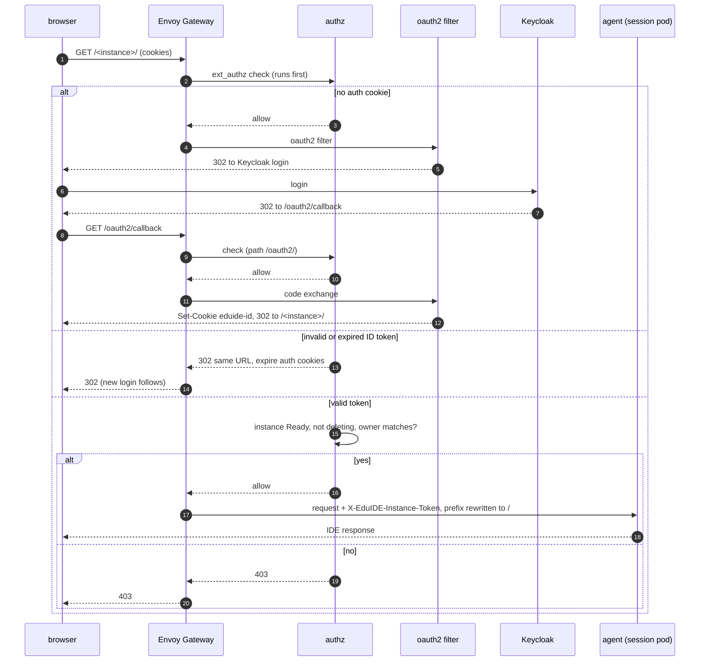

# Session access

Who may open which IDE, and how the gateway decides. Source: [ADR 0005](../adr/0005-session-auth-at-gateway.md). Metrics: `eduide_authz_decisions_total`, `eduide_authz_check_seconds`.

## Components

- One `SecurityPolicy` (Envoy Gateway) per deployment selects all HTTPRoutes with the label `eduide.github.io/route=session`. It configures the `oidc` filter (Keycloak realm of the deployment, confidential gateway client `oidc.gatewayClientID`, ID token cookie `oidc.idTokenCookie`, refresh token) and `extAuth` to `authz` over gRPC with `failOpen: false`.
- `authz` keeps its own informer on `IDESession` objects and makes no API call per request.
- Each session route also sets `X-EduIDE-Instance-Token`. The agent forwards only requests with that token. This is the second line, next to the NetworkPolicy.
- The chart adds an HTTPRoute for `/oauth2/` on the instance host (label `route=session`, target: the service, answers 404) so the OIDC callback has a route.

## Filter order finding

Envoy Gateway runs the HTTP filters in a fixed order: ext_authz (position 5) before oauth2 (8) and jwt_authn (9). Verified in Envoy Gateway v1.8.3 (`internal/xds/translator/httpfilters.go`). The shared EnvoyProxy of the cluster sets no `filterOrder` and we do not change it.

Consequence: when `authz` runs, the OIDC filter has neither validated the token nor set a header. `authz` cannot trust headers derived from the token. It verifies the ID token cookie itself (go-oidc, JWKS cached, issuer `oidc.issuerURL`, audience `oidc.gatewayClientID`).

## Decision

For every request on a session route, in this order:

| Case | Answer |
|---|---|
| Path starts with `/oauth2/` | allow |
| No auth cookie at all: no ID token cookie and no cookie named `BearerToken*`, `OauthHMAC*`, `OauthExpires*`, `IdToken*`, `RefreshToken*` | allow; the oauth2 filter runs next and forces the login, so nothing reaches the IDE |
| ID token cookie present but invalid or expired | 302 to the same URL with `Set-Cookie` expiring all those cookies (Domain `hosts.instance`, Path `/`); the next request logs in again, silent through Keycloak SSO |
| No valid ID token, but an `eduide-authz` cookie whose HMAC verifies, which has not expired and which is bound to the request's only `RefreshToken*` cookie | its owner counts like a valid token's in the rows below |
| Valid token, first path segment is the `status.instance` of an `IDESession` in phase `Ready`, not being deleted, and `spec.owner` equals the token claim `oidc.userClaim` | allow |
| Valid token, anything else (unknown, free, foreign, released instance) | 403 |
| Internal error | 403 |

The instance id is random and unguessable, so allowing a request without cookies leaks nothing about sessions.
The oauth2 filter redirects only page navigations to Keycloak; XHR, fetch and WebSocket requests (`Sec-Fetch-Mode` other than `navigate`) get a 401 (`oidc.denyRedirect`), because they cannot follow the redirect and each redirect leaves two login flow cookies behind.
The ID token cookie lives only as long as the token, so `authz` keeps the owner in its own signed cookie `eduide-authz`, bound to the refresh token cookie; without an ID token it accepts that cookie with the same refresh token, and the oauth2 filter then refreshes the tokens or restarts the login (ADR 0005, amendment 2026-11-19).
Release removes access first: the session leaves `Ready`, `authz` denies at once, then the operator deletes the pod.
WebSockets are checked at the upgrade request.

## Tradeoffs

- `authz` verifies a JWT per request (keys cached). An expired token costs one extra redirect.
- Case "no auth cookie" relies on the oauth2 filter running after ext_authz. The e2e suite requests a session route without cookies and expects a login redirect, never IDE content.
- If a cluster allows an own EnvoyProxy with `filterOrder`, `authz` can trust Envoy-set headers and drop the token check. **Planned** follow-up, not built.
- Fallback if the gateway spike fails in a cluster: oauth2-proxy per pod with an e-mail file written by the agent. Not built.
- The cookie domain covers the instance host and the webview host.

Failure behavior: if `authz` is down, nobody gets into a new IDE. Open WebSockets stay up. See the [authz runbook](../operations/authz-errors.md).

## API tokens and the IDE origin

The REST API, including the approval of Git repositories ([ADR 0023](../adr/0023-git-accounts-and-git-proxy.md)), accepts a bearer token of a client in `oidc.clientIDs`. Code in the pod and script in the IDE's origin must not be able to get one. What holds today:

- The agent strips the gateway's login cookies from every request to the IDE and drops cookies of those names that the IDE sets. The oauth2 filter sets no `Authorization` header towards the IDE.
- The ID token cookie is set by Envoy with `Secure; HttpOnly`; the e2e test `TestGatewayAuth` fails otherwise.
- The gateway client is confidential and separate from the landing page client. Script in the instance or webview origin cannot finish an OIDC flow for it (no secret), and the API rejects its ID token (`azp` is not in `oidc.clientIDs`).

The last point needs two clients. With one client in both `oidc.clientIDs` and `oidc.gatewayClientID` the client is public, and script in the IDE origin can run an authorization code flow with PKCE against Keycloak, read the code on its own origin and call the API as the user. Do not fix it by making the shared client confidential: the landing page login breaks. Create a new gateway client. The Keycloak settings and the migration steps are in [install.md](../operations/install.md#migrate-from-one-shared-client).
