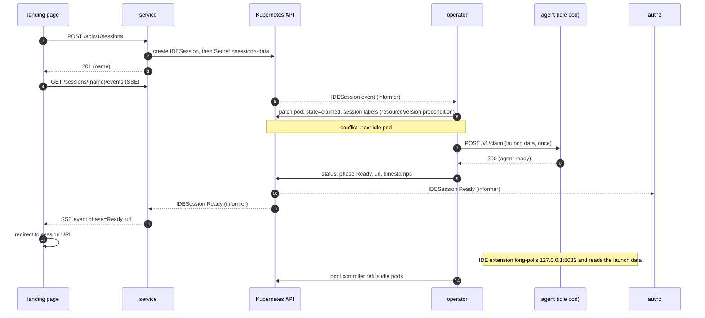
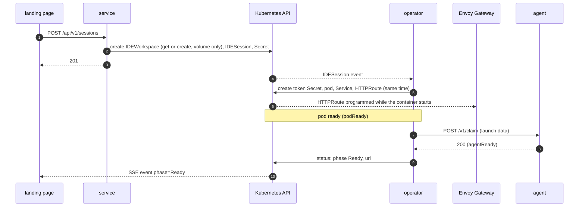

# Start path

How a launch becomes a reachable IDE. Decisions: [ADR 0009](../adr/0009-claim-protocol.md) (claim), [ADR 0006](../adr/0006-agent-sidecar.md) (agent), [ADR 0007](../adr/0007-persistence-modes.md) (persistence), [ADR 0004](../adr/0004-gateway-api-only.md) (routes).

| Strategy (`status.startStrategy`) | When |
|---|---|
| `warm-ready` | An idle, ready instance of the template's pool exists and the session has no workspace |
| `warm-starting` | No ready instance, but an idle one is still starting; the session waits for it |
| `cold` | No pool, no idle instance, or the session has a workspace (a volume cannot attach to a running pod) |

Under capacity pressure a claim does not wait for idle pods ([ADR 0008](../adr/0008-idepool-scale-bare-pods.md)).

## Warm start



Service and HTTPRoute of the pod exist since prewarming. The claim changes labels only, so the gateway does not change.

## Cold start



With `volume`, the pod mounts the workspace PVC at the template `persistence.mountPath`.
**Planned:** an image prepull per template (DaemonSet with init containers, pull only) keeps IDE images warm on the session nodes. The setting is `placement.prepull.enabled` in the config.

## Phases and timestamps

| Phase | Meaning | Timestamp set when entering the next step |
|---|---|---|
| `Pending` | Session created, operator has not started the instance | none |
| `Starting` | Instance chosen (claim or pod creation) | `status.timestamps.claimed` when the instance is assigned |
| | Pod ready | `status.timestamps.podReady` |
| | Agent accepted the launch data | `status.timestamps.agentReady` |
| `Ready` | Reachable, `status.url` set | `status.timestamps.ready` |
| `Failed` | `status.errorCode` and `status.message` set | none |

Phase durations are exported as `eduide_session_phase_seconds{phase=claim|pod_ready|agent_ready, strategy}`.
The whole start is `eduide_session_startup_seconds{template, strategy, result}`, from creation of the `IDESession` to `Ready` or `Failed`.
Metric names: [docs/contracts/metrics.md](../contracts/metrics.md).

Read the timestamps of a session:

```bash
kubectl -n <namespace> get idesession <name> -o jsonpath='{.status.startStrategy}{"\n"}{.status.timestamps}{"\n"}'
```

## Time budgets

Proposal, to be calibrated against the measured baseline:

| Case | Target p95 until the IDE is reachable |
|---|---|
| warm, `none` | < 2 s |
| cold (`none` or `volume`) | < 30 s, dominated by the IDE start |

**Planned:** the warm budget becomes a CI gate with a start path benchmark. Today it is a target, not a check.

Load targets per deployment: 1000 concurrent sessions, a burst of 200 launches per minute, control plane below 150 MiB in total.

## Traces

The landing page sends `traceparent`. The service stores it in the annotation `eduide.github.io/traceparent` of the session. The operator continues the trace with one span `start` (session creation until Ready) and one child span per phase. After Ready it adds spans from the milestones of the agent. The agent itself exports nothing: it keeps milestone timestamps in memory and the operator turns them into spans. See [operations/tracing.md](../operations/tracing.md).
Start path traces are sampled at 100 percent. Spans carry no e-mail address or name, only a pseudonymous user id and the session name ([ADR 0013](../adr/0013-observability.md)).
Debug a slow launch: [slow-launch runbook](../operations/slow-launch.md).
